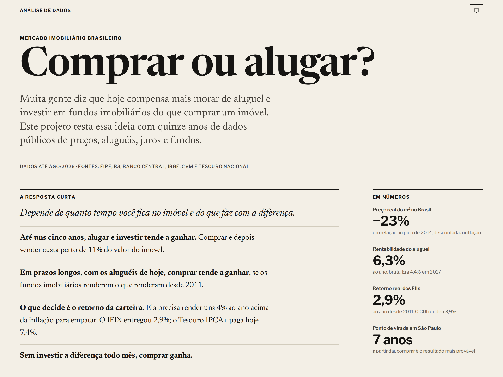
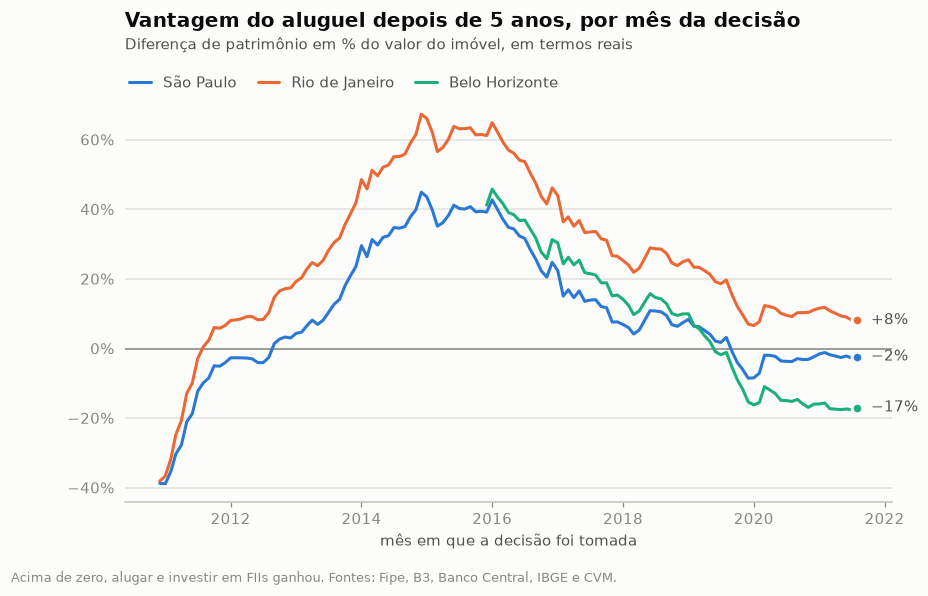

# 🏠 Comprar ou alugar?

**Compensa mais morar de aluguel e investir em fundos imobiliários do que comprar um imóvel?**
Uma análise de dados do mercado imobiliário brasileiro, com quinze anos de dados públicos, cinco notebooks e um
simulador interativo.



## A resposta curta

Depende de quanto tempo você fica no imóvel e do que faz com a diferença. Com dados até agosto de 2026:

- **Até uns cinco anos, alugar e investir tende a ganhar.** Comprar e depois vender custa perto de 11% do valor do
  imóvel (ITBI, cartório e corretagem).
- **Em prazos longos, com os aluguéis de hoje, comprar tende a ganhar**, se os fundos imobiliários renderem o que
  renderam desde 2011. Em São Paulo, a virada acontece por volta do sétimo ano; no Rio e em Belo Horizonte, perto
  do décimo quinto.
- **O que decide é o retorno da carteira.** Ela precisa render uns 4% ao ano acima da inflação para empatar no longo
  prazo. O IFIX entregou 2,9%; o Tesouro IPCA+ paga hoje 7,4%.
- **Sem investir a diferença todo mês, comprar ganha.** Quem investe só metade vê a chance de sair na frente em dez
  anos cair de 39% para 18%.

A hipótese inicial ("hoje compensa alugar e investir em FIIs") se confirma no passado recente e no curto prazo, e
não se confirma para quem pretende ficar muitos anos no mesmo imóvel.

## O que os dados mostram

### 1. O imóvel valorizou menos do que parece

O preço anunciado do m² subiu 347% desde 2008, mas descontada a inflação está **23% abaixo do pico de 2014** (45%
no Rio). Em dez anos, 15 das 25 cidades com série longa perderam para a inflação.


### 2. O aluguel ficou caro, e os FIIs renderam menos que o CDI

A rentabilidade bruta do aluguel está em 6,3% ao ano, a mais alta em mais de uma década (era 4,4% em 2017): os
aluguéis subiram 41% acima da inflação em cinco anos. De 2011 a 2026, o IFIX rendeu 2,9% ao ano acima da inflação,
contra 3,9% do CDI e 4,6% de um apartamento alugado em São Paulo, com muito mais oscilação.

### 3. No passado, alugar e investir ganhou na maioria das vezes

Simulando a decisão em cada mês desde dezembro de 2010, com preços, aluguéis, juros e IFIX reais: em janelas de
cinco anos, alugar e investir venceu em 65% das vezes em São Paulo, 94% no Rio e 61% em Belo Horizonte. O que mais
pesou foi a queda real dos imóveis depois de 2014, e não o desempenho dos fundos.



### 4. Para quem decide hoje, o prazo muda tudo

Partindo dos preços e juros de hoje e sorteando 10 mil futuros a partir da história de cada cidade:


### 5. O ponto de equilíbrio

Para cada combinação de valorização do imóvel e retorno da carteira, quem ganha em 20 anos:


## Os notebooks

| Notebook | Pergunta |
|---|---|
| [01_precos](notebooks/01_precos.ipynb) | Quanto os imóveis valorizaram de verdade, descontada a inflação? |
| [02_aluguel](notebooks/02_aluguel.ipynb) | Quanto rende um aluguel, e como isso se compara ao juro real? |
| [03_imovel_fii_renda_fixa](notebooks/03_imovel_fii_renda_fixa.ipynb) | Imóvel, fundos imobiliários ou CDI: retorno e risco desde 2011 |
| [04_comprar_ou_alugar](notebooks/04_comprar_ou_alugar.ipynb) | A simulação: backtest, Monte Carlo, sensibilidade e conclusões |
| [05_varginha](notebooks/05_varginha.ipynb) | O que dá para dizer de uma cidade sem índice de preços |

## A página

Uma página só, com a história contada em gráficos e um simulador para testar o seu próprio cenário: cidade, preço,
aluguel, juros, prazo e o que você espera do imóvel e da carteira.


O simulador da página (TypeScript) e o da análise (Python) são duas implementações da mesma conta. O Python exporta
casos de teste e os testes do site conferem que os dois dão os mesmos números.

## Como a conta é feita

Duas pessoas começam com o mesmo dinheiro e gastam o mesmo todo mês. Uma dá entrada e financia; a outra aluga um
imóvel igual e investe a entrada e a diferença de cada mês. No fim, compara-se o patrimônio de cada uma, em valores
de hoje. As premissas, as fontes e as limitações estão em [METODOLOGIA.md](METODOLOGIA.md).

## Dados

| Dado | Fonte |
|---|---|
| Preço de venda e de aluguel do m², 56 cidades, desde 2008 | [Índice FipeZAP](https://www.fipe.org.br/pt-br/indices/fipezap/) (Fipe) |
| IFIX, índice de fundos imobiliários | [B3](https://www.b3.com.br/pt_br/market-data-e-indices/indices/indices-de-segmentos-e-setoriais/indice-de-fundos-de-investimentos-imobiliarios-ifix.htm) |
| Rendimentos distribuídos pelos FIIs | [Informe mensal dos FIIs](https://dados.cvm.gov.br/dataset/fii-doc-inf_mensal) (CVM) |
| IPCA | [SIDRA, tabela 1737](https://sidra.ibge.gov.br/tabela/1737) (IBGE) |
| CDI, IGP-M, IVG-R e juros do financiamento imobiliário | [SGS](https://www3.bcb.gov.br/sgspub/) (Banco Central) |
| Taxas do Tesouro IPCA+ | [Tesouro Transparente](https://www.tesourotransparente.gov.br/ckan/dataset/taxas-dos-titulos-ofertados-pelo-tesouro-direto) |
| Anúncios de apartamentos em Varginha | Amostra pontual, em `data/manual/varginha_anuncios.csv` |

## Como rodar

Precisa de [uv](https://docs.astral.sh/uv/) (Python) e de Node.js 24.

```bash
uv sync                                 # instala as dependências
uv run python -m comprar_ou_alugar      # baixa as fontes, trata e exporta os dados da página
uv run pytest                           # testes
uv run jupyter lab notebooks            # abre os notebooks
```

`uv run python -m comprar_ou_alugar --atualizar` baixa as fontes de novo, mesmo que já estejam em `data/raw`.

A página:

```bash
cd site
npm install
npm test         # confere o simulador em TypeScript contra o de Python
npm run dev      # http://localhost:5173
```

## Estrutura

```
src/comprar_ou_alugar/
  fontes/            um módulo por fonte de dados (baixar + ler)
  tratamento.py      junta as fontes em tabelas mensais
  financiamento.py   tabelas SAC e Price
  simulador.py       comprar × alugar e investir, mês a mês
  cenarios.py        backtest, Monte Carlo e sensibilidade
  analise.py         medidas de retorno e risco
  estilo.py          aparência dos gráficos
  exportar_site.py   dados e casos de teste para a página
tests/               testes dos leitores, do simulador e das tabelas tratadas
notebooks/           a análise, em cinco partes
data/processed/      tabelas tratadas (parquet)
site/                a página (Vite + React + TypeScript)
```

## Limitações

- O FipeZAP mede **preço de anúncio** de **apartamentos prontos**: não é o preço de fechamento e não cobre casas.
- O IFIX existe desde 2011. Quinze anos contêm um único ciclo imobiliário, e as simulações não inventam o que essa
  história não tem.
- Ficaram de fora os seguros do financiamento, o FGTS, os subsídios do Minha Casa Minha Vida e os custos de mudança.
- Varginha não tem índice de preços: a análise usa uma amostra de 40 anúncios, com margem de erro grande.
- A segurança de ter casa própria e a liberdade de se mudar não entram na conta.

Isto é um estudo, não uma recomendação de investimento.

## Stack

Python 3.14, pandas, NumPy, matplotlib, pytest e ruff, gerenciados com uv. Página em React 19, TypeScript e Vite,
com gráficos em SVG (d3-scale e d3-shape).
