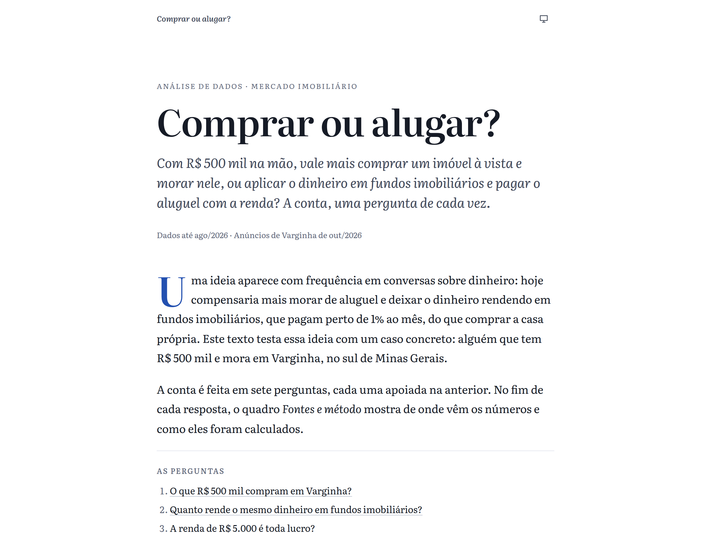
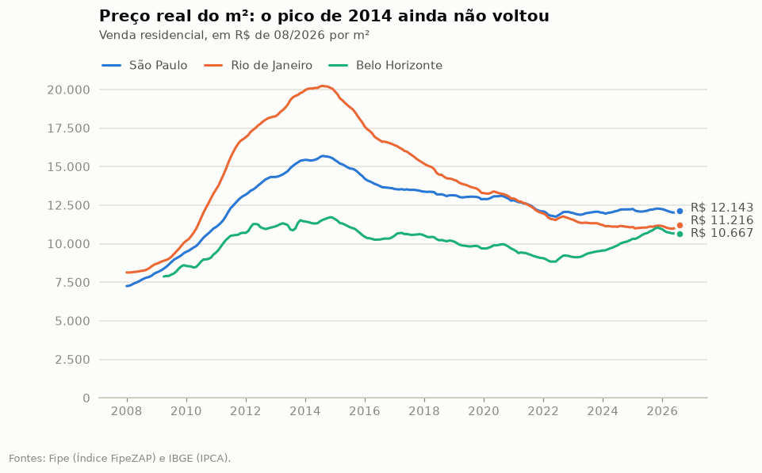
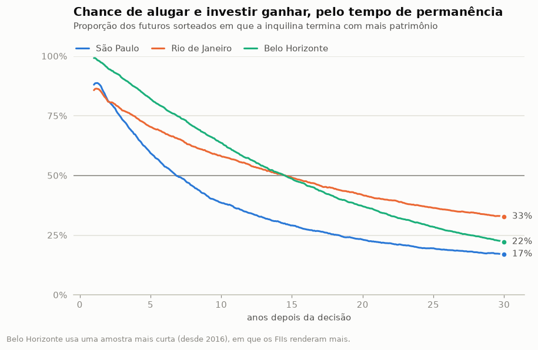
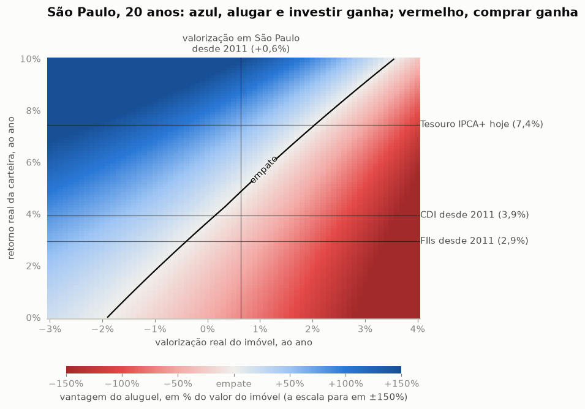
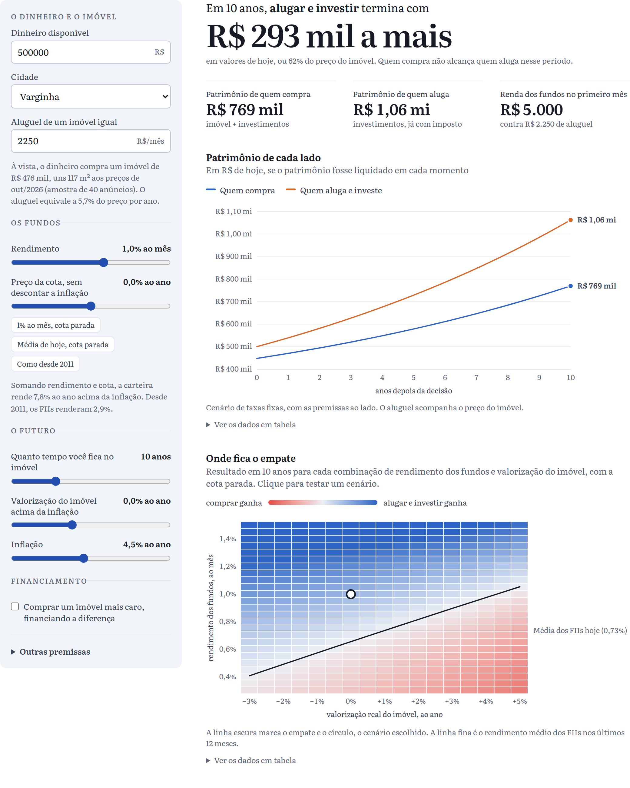

# 🏠 Comprar ou alugar?

**Com R$ 500 mil na mão, vale mais comprar um imóvel à vista e morar nele, ou aplicar em fundos imobiliários que
rendem 1% ao mês e pagar o aluguel com essa renda?** Uma análise de dados do mercado imobiliário brasileiro, com
quinze anos de dados públicos, seis notebooks e um simulador interativo.

**A página:** https://posts.igreg.dev/comprar-ou-alugar/



## A resposta curta

Depende de quanto os fundos rendem de verdade, depois de descontar a inflação. No exemplo da página, Varginha (MG),
R$ 500 mil compram à vista um apartamento de R$ 476 mil (117 m²), que aluga por R$ 2.253 por mês. Com dados até
agosto de 2026:

- **Se o 1% ao mês continuar e a cota não cair, alugar e investir ganha com folga**: R$ 293 mil a mais em dez anos,
  em dinheiro de hoje.
- **Parte do 1% é só inflação.** Dos R$ 5.000 de renda por mês, R$ 1.837 apenas repõem o que a inflação tira dos
  R$ 500 mil se a cota ficar parada.
- **A conta empata perto do que os fundos pagam hoje.** Em 20 anos, as duas escolhas empatam com cerca de 0,70% ao mês. Nos
  últimos 12 meses, os FIIs distribuíram em média 0,73% ao mês sobre o valor patrimonial.
- **Se os fundos repetirem o que fizeram desde 2011, comprar ganha**: R$ 141 mil a mais em 20 anos. O IFIX rendeu
  2,9% ao ano acima da inflação no período, menos que o CDI.

| Os fundos rendem | 5 anos | 10 anos | 20 anos | 30 anos |
|---|---:|---:|---:|---:|
| 1% ao mês, cota parada | +150 | +293 | +803 | +1.888 |
| Média dos FIIs hoje (0,73% ao mês), cota parada | +54 | +55 | +59 | +66 |
| Como desde 2011 (2,9% ao ano acima da inflação) | +14 | −30 | −141 | −289 |

Vantagem de quem aluga e investe, em milhares de reais de hoje, com o imóvel e o aluguel acompanhando a inflação.
Negativo: quem compra termina com mais. A conta está no [notebook 6](notebooks/06_a_vista.ipynb).

A hipótese inicial ("hoje compensa alugar e investir em FIIs") se confirma se os fundos mantiverem 1% ao mês sem
perder valor de cota, o que fica bem acima do que entregaram desde 2011.

## A análise com financiamento

Os notebooks 1 a 5 fazem a mesma pergunta para quem compra financiado, em São Paulo, no Rio e em Belo Horizonte.

### 1. O imóvel valorizou menos do que parece

O preço anunciado do m² subiu 347% desde 2008, mas descontada a inflação está **23% abaixo do pico de 2014** (45%
no Rio). Em dez anos, 15 das 25 cidades com série longa perderam para a inflação.



### 2. O aluguel ficou caro, e os FIIs renderam menos que o CDI

A rentabilidade bruta do aluguel, no índice nacional, está em 6,3% ao ano, a mais alta em mais de uma década (era 4,4% em 2017): os
aluguéis subiram 41% acima da inflação em cinco anos. De 2011 a 2026, o IFIX rendeu 2,9% ao ano acima da inflação,
contra 3,9% do CDI e 4,6% de um apartamento alugado em São Paulo, com muito mais oscilação.

### 3. No passado, alugar e investir ganhou na maioria das vezes

Simulando a decisão em cada mês desde dezembro de 2010, com preços, aluguéis, juros e IFIX reais: em janelas de
cinco anos, alugar e investir venceu em 65% das vezes em São Paulo, 94% no Rio e 61% em Belo Horizonte. O que mais
pesou foi a queda real dos imóveis depois de 2014, e não o desempenho dos fundos.


### 4. Para quem financia hoje, o prazo muda tudo

Partindo dos preços e juros de hoje e sorteando 10 mil futuros a partir da história de cada cidade: até uns cinco
anos, alugar e investir tende a ganhar; em São Paulo, a virada acontece por volta do sétimo ano.



### 5. O ponto de equilíbrio

Para cada combinação de valorização do imóvel e retorno da carteira, quem ganha em 20 anos:



## Os notebooks

| Notebook | Pergunta |
|---|---|
| [01_precos](notebooks/01_precos.ipynb) | Quanto os imóveis valorizaram de verdade, descontada a inflação? |
| [02_aluguel](notebooks/02_aluguel.ipynb) | Quanto rende um aluguel, e como isso se compara ao juro real? |
| [03_imovel_fii_renda_fixa](notebooks/03_imovel_fii_renda_fixa.ipynb) | Imóvel, fundos imobiliários ou CDI: retorno e risco desde 2011 |
| [04_comprar_ou_alugar](notebooks/04_comprar_ou_alugar.ipynb) | A simulação: backtest, Monte Carlo, sensibilidade e conclusões |
| [05_varginha](notebooks/05_varginha.ipynb) | O que dá para dizer de uma cidade sem índice de preços |
| [06_a_vista](notebooks/06_a_vista.ipynb) | R$ 500 mil à vista: comprar ou aplicar em FIIs a 1% ao mês e alugar? |

## A página

Um artigo em sete perguntas encadeadas, do que R$ 500 mil compram em Varginha até quem termina com mais dinheiro.
Cada resposta termina com um bloco "Fontes e método", com os links para os dados e para o notebook ou o código em
que a conta está feita. No fim, um simulador para testar o seu próprio cenário: dinheiro disponível, cidade,
aluguel, rendimento dos fundos, preço da cota e o que você espera do imóvel. Quem quiser comprar um imóvel mais caro
pode financiar parte dele. A página tem tema claro e escuro.



O simulador da página (TypeScript) e o da análise (Python) são duas implementações da mesma conta. O Python exporta
casos de teste e os testes do site conferem que os dois dão os mesmos números.

## Como a conta é feita

Duas pessoas começam com o mesmo dinheiro e gastam o mesmo todo mês. Uma compra o imóvel (à vista, ou dando
entrada e financiando); a outra aluga um imóvel igual e investe o dinheiro. Quem gasta menos no mês investe a
diferença: à vista, é quem compra, que não paga aluguel. No fim, compara-se o patrimônio de cada uma, em valores de
hoje. As premissas, as fontes e as limitações estão em [METODOLOGIA.md](METODOLOGIA.md).

## Dados

| Dado | Fonte |
|---|---|
| Preço de venda e de aluguel do m², 56 cidades, desde 2008 | [Índice FipeZAP](https://www.fipe.org.br/pt-br/indices/fipezap/) (Fipe) |
| IFIX, índice de fundos imobiliários | [B3](https://www.b3.com.br/pt_br/market-data-e-indices/indices/indices-de-segmentos-e-setoriais/indice-de-fundos-de-investimentos-imobiliarios-ifix.htm) |
| Rendimentos distribuídos pelos FIIs | [Informe mensal dos FIIs](https://dados.cvm.gov.br/dataset/fii-doc-inf_mensal) (CVM) |
| IPCA | [SIDRA, tabela 1737](https://sidra.ibge.gov.br/tabela/1737) (IBGE) |
| CDI, IGP-M, IVG-R e juros do financiamento imobiliário | [SGS](https://www3.bcb.gov.br/sgspub/) (Banco Central) |
| Taxas do Tesouro IPCA+ | [Tesouro Transparente](https://www.tesourotransparente.gov.br/ckan/dataset/taxas-dos-titulos-ofertados-pelo-tesouro-direto) |
| Anúncios de apartamentos em Varginha | Amostra pontual, em `dados/manuais/varginha_anuncios.csv` |

## Como rodar

Este post faz parte do [iblog](../../README.md) e tudo roda a partir da raiz do repositório. Precisa de
[uv](https://docs.astral.sh/uv/) (Python) e de Node.js 24.

```bash
uv sync                                               # instala as dependências
uv run python -m comprar_ou_alugar                    # baixa as fontes, trata e exporta os dados da página
uv run pytest posts/comprar-ou-alugar                 # testes
uv run jupyter lab posts/comprar-ou-alugar/notebooks  # abre os notebooks
```

`uv run python -m comprar_ou_alugar --atualizar` baixa as fontes de novo, mesmo que já estejam em `dados/brutos`.

A página:

```bash
npm install
npm test         # confere o simulador em TypeScript contra o de Python
npm run dev      # http://localhost:5173/comprar-ou-alugar/
```

## Estrutura

```
post.json            título, resumo e data: é o que a capa do blog mostra
pagina/              a página (React + TypeScript) e o dados.json que ela lê
analise/             o pipeline em Python (pacote `comprar_ou_alugar`)
  fontes/            um módulo por fonte de dados (baixar + ler)
  tratamento.py      junta as fontes em tabelas mensais
  financiamento.py   tabelas SAC e Price
  simulador.py       comprar × alugar e investir, mês a mês
  cenarios.py        compra à vista, backtest, Monte Carlo e sensibilidade
  analise.py         medidas de retorno e risco
  estilo.py          aparência dos gráficos
  exportar_site.py   dados e casos de teste para a página
testes/              testes dos leitores, do simulador e das tabelas tratadas (Python e TypeScript)
notebooks/           a análise, em seis partes
dados/tratados/      tabelas tratadas (parquet)
dados/manuais/       a amostra de anúncios de Varginha
```

## Limitações

- O FipeZAP mede **preço de anúncio** de **apartamentos prontos**: não é o preço de fechamento e não cobre casas.
- O IFIX existe desde 2011. Quinze anos contêm um único ciclo imobiliário, e as simulações não inventam o que essa
  história não tem.
- Ficaram de fora os seguros do financiamento, o FGTS, os subsídios do Minha Casa Minha Vida e os custos de mudança.
- Varginha não tem índice de preços: a análise usa uma amostra de 40 anúncios, com margem de erro grande.
- O rendimento dos FIIs medido pela CVM é sobre o valor patrimonial da cota. Fundos que pagam acima da média
  costumam ter mais risco, e as regras de imposto dos fundos podem mudar.
- A segurança de ter casa própria e a liberdade de se mudar não entram na conta.

Isto é um estudo, não uma recomendação de investimento.

## Stack

Python 3.14, pandas, NumPy, matplotlib, pytest e ruff, gerenciados com uv. Página em React 19, TypeScript e Vite,
com gráficos em SVG (d3-scale e d3-shape).
