# 📉 O juro é negativo?

**Depois de 2008, nenhum investimento tradicional rende mais que a inflação?**
Uma checagem, com dados públicos, do texto
["O Juro é negativo após 2008"](https://amoedo.substack.com/p/o-juro-e-negativo-apos-2008), do Trezoitão
(Renato Amoedo), publicado em outubro de 2022. Seis notebooks, 31 anos de dados e uma página com calculadora.

**A página:** https://posts.igreg.dev/juros-negativos/

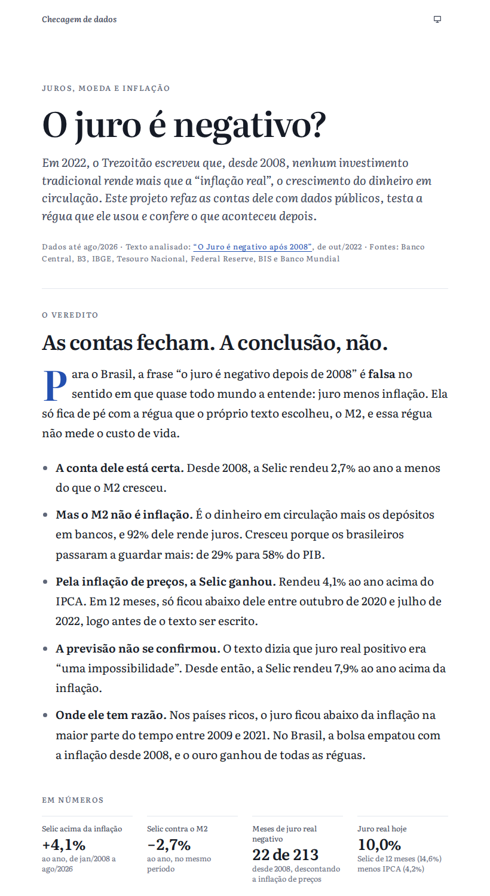

## A resposta curta

**As contas fecham. A conclusão, não.** Para o Brasil, a frase "o juro é negativo depois de 2008" é falsa no sentido
em que quase todo mundo a entende (juro menos inflação). Ela só fica de pé com a régua que o próprio texto escolheu,
o M2, e essa régua não mede o custo de vida. Com dados até agosto de 2026:

- **A conta do texto está certa.** Desde 2008, a Selic rendeu 2,7% ao ano a menos do que o M2 cresceu. Em janelas
  de dez anos começadas desde 2008, perdeu em 95% das vezes.
- **Mas o M2 não é inflação.** É o dinheiro em circulação mais os depósitos em bancos, e 92% dele rende juros.
  Cresceu porque os brasileiros passaram a guardar mais: de 29% para 58% do PIB.
- **Pela inflação de preços, a Selic ganhou.** Rendeu 4,1% ao ano acima do IPCA e ganhou dele em 16 dos 18 anos
  desde 2008. Só perdeu em 2020 e 2021, na pandemia, logo antes de o texto ser escrito.
- **A previsão não se confirmou.** O texto dizia que juro real positivo era "uma impossibilidade". Desde então, a
  Selic rendeu 7,9% ao ano acima da inflação.
- **Onde o texto tem razão.** Nos países ricos, o juro ficou abaixo da inflação em mais de 80% dos meses entre 2009
  e 2021. No Brasil, a bolsa empatou com a inflação desde 2008, o ouro ganhou de todas as réguas, e os números de
  população conferem.

"Falso" aqui quer dizer que a afirmação não resiste aos dados, não que alguém mentiu: os números do texto podem ser
refeitos por qualquer pessoa, e quase todos conferem.

## Afirmação por afirmação

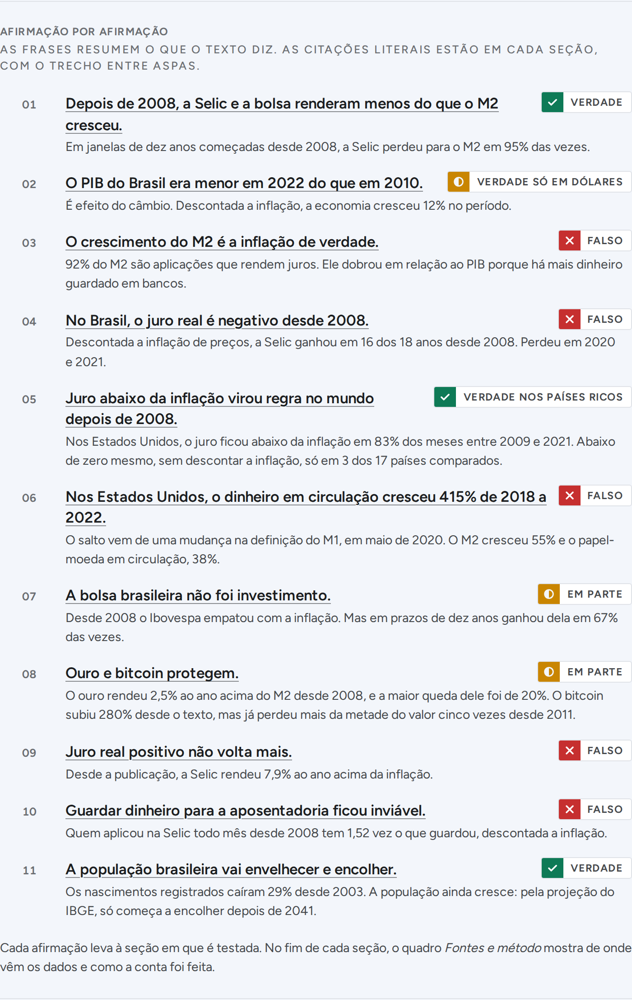

## O que os dados mostram

### 1. Os números do texto, no essencial, estão certos

Dos 36 números citados, 21 batem com menos de 5% de diferença, e os de Selic e CDI batem na vírgula. Os erros são de
digitação (o Ibovespa de 2008 a 2018 aparece como 119,6%; o certo é 19,6%) e de data, e não mudam as comparações
feitas para o Brasil. Antes de 2008 os investimentos ganhavam do M2; depois, não.

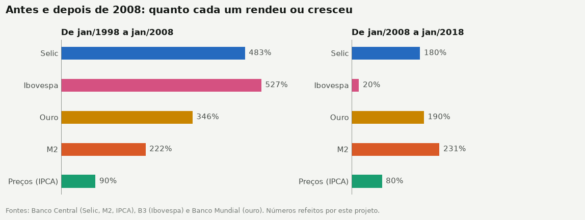

### 2. O resultado depende da régua, e a do texto não mede inflação

A mesma aplicação na Selic, medida de quatro jeitos. Ganha dos preços, da base monetária (o dinheiro que o Banco
Central emite) e do PIB nominal. Só perde do M2.

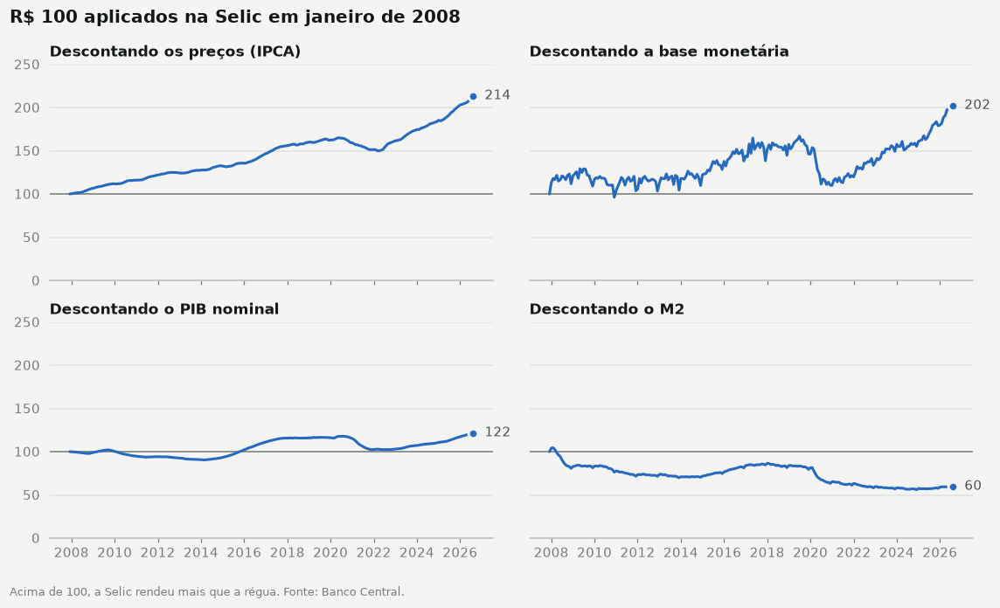

R$ 100 aplicados na Selic em 2008 compram hoje mais de quase tudo: 114% mais da cesta do IPCA, 46% mais imóveis,
40% mais salários mínimos. Só compram menos ouro, e uma fatia menor do M2.

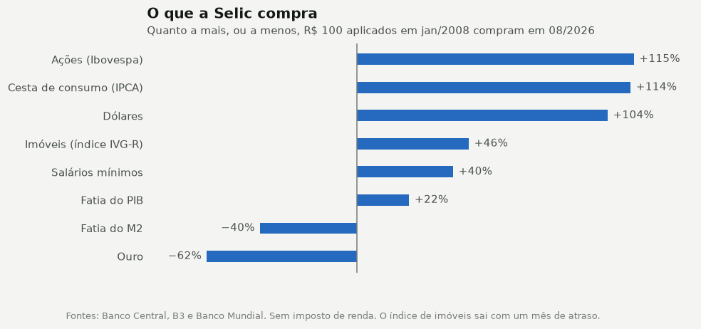

### 3. O juro real brasileiro caiu muito, mas não ficou negativo

De 13,6% ao ano em média (1996 a 2007) para 3,0% (2008 até o texto). Abaixo de zero, só na pandemia: ano a ano, a
Selic rendeu mais que a inflação em 16 dos 18 anos de 2008 a 2025.

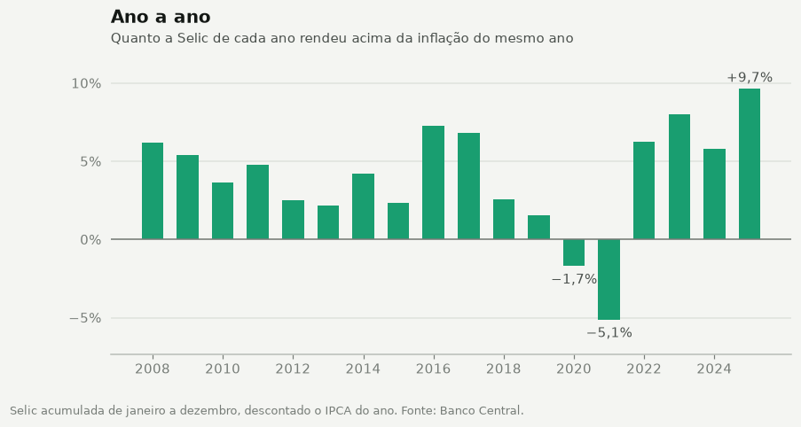

Mês a mês, o "juro negativo" do texto é a linha laranja: a Selic descontada pelo crescimento do M2.

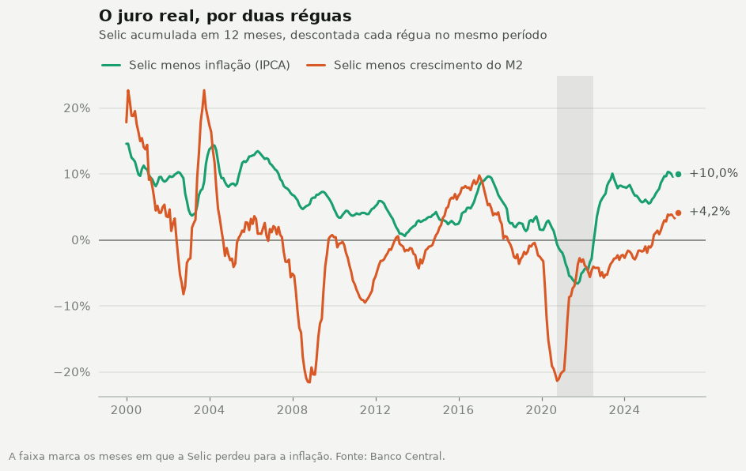

### 4. Nos países ricos, o juro negativo existiu

O juro básico descontada a inflação, em 17 países. A faixa vermelha de 2009 a 2021 é real. A linha do Brasil é
quase toda azul. Abaixo de zero mesmo, sem descontar a inflação, o juro básico só ficou em 3 dos 17 países (Suíça,
Japão e Suécia), além da taxa de depósito da zona do euro: existiu e durou anos, mas em poucos lugares.

Já o salto de 415% do dinheiro em circulação nos Estados Unidos, que o texto cita, é uma mudança na definição do M1
feita em maio de 2020. De 2018 a 2022, o M2 cresceu 55%, a base monetária, 67%, e o papel-moeda em circulação, 38%:
todos menos que a bolsa. Um ponto a favor do texto: na década anterior, de 2008 a 2018, a base monetária americana
multiplicou por 4,6, bem mais que a bolsa, embora três quartos desse aumento tenham sido reservas dos bancos.

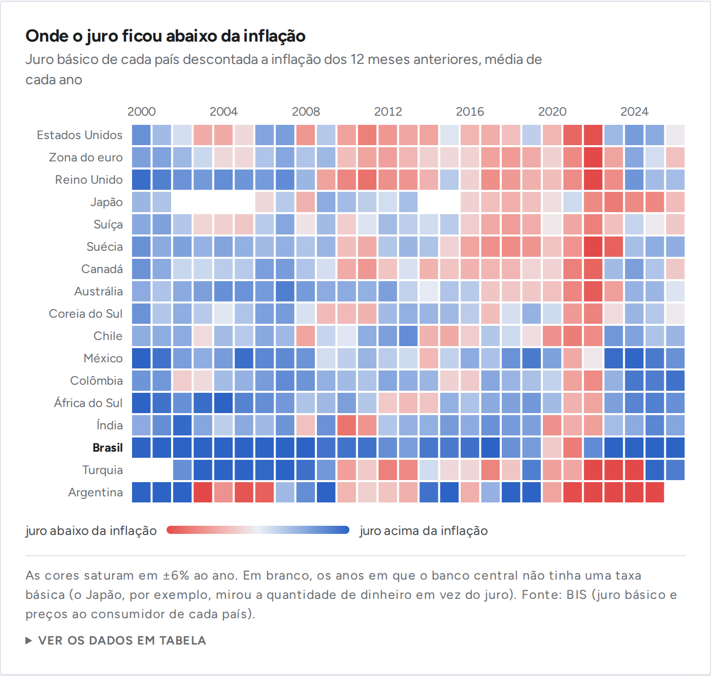

### 5. Depois do texto, o juro real voltou

De outubro de 2022 a agosto de 2026, a Selic rendeu 62% contra 20% de inflação, e empatou até com o M2 (60%). Ouro
e bitcoin, as proteções que o texto recomenda, subiram muito mais.

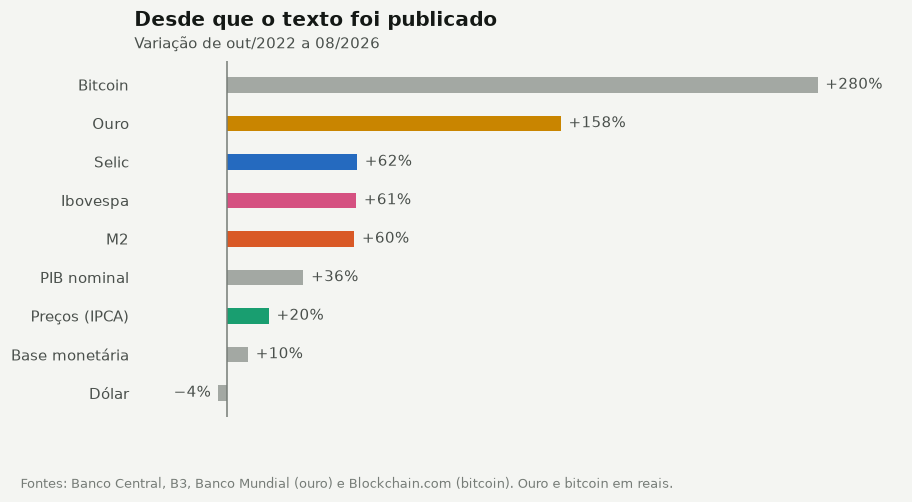

Proteger, porém, é mais do que render. O ouro ganhou de todas as réguas, e a maior queda dele foi de 20%. O bitcoin rendeu
mais que tudo, mas perdeu mais da metade do valor cinco vezes desde 2011, uma delas já depois do texto (53% entre
julho de 2025 e junho de 2026). Quem comprou no pico de outubro de 2021 tem hoje 16% a mais, contra uma inflação de
27%. Por isso "ouro e bitcoin protegem" ficou como verdade em parte.

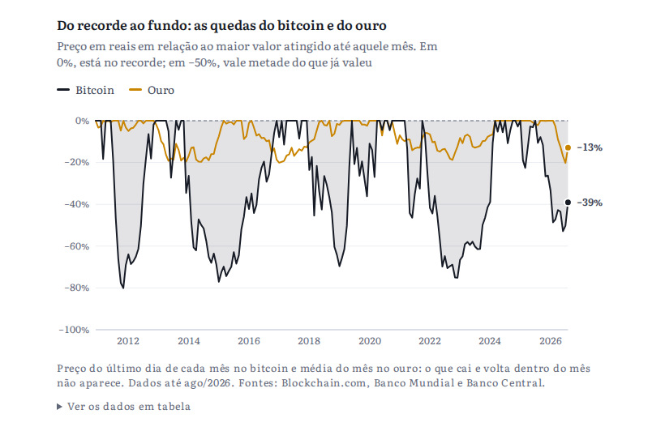

### 6. A população envelhece, mas guardar dinheiro não ficou inviável

Os números de população do texto conferem: fecundidade abaixo da reposição desde 2002, nascimentos 29% abaixo de
2003, o dobro de idosos por trabalhador até 2050. A queda da população, porém, ainda é projeção: pelo IBGE, ela
cresce até 2041 e depois cai devagar (9,6% até 2070), longe dos "poucos anos" e da queda "exponencial" do texto.
Já a ideia de que poupar para a aposentadoria é inviável não
resiste: quem aplicou na Selic todo mês desde 2008 tem 1,52 vez o que guardou, descontada a inflação.

## Os notebooks

| Notebook | Pergunta |
|---|---|
| [01_as_contas_do_texto](notebooks/01_as_contas_do_texto.ipynb) | Os 36 números citados no texto conferem? |
| [02_a_regua](notebooks/02_a_regua.ipynb) | O M2 é a inflação de verdade? Do que ele é feito e por que cresce |
| [03_juro_real](notebooks/03_juro_real.ipynb) | O juro real foi negativo depois de 2008? Ano a ano, em 12 meses, em janelas longas e no Tesouro IPCA+ |
| [04_no_mundo](notebooks/04_no_mundo.ipynb) | E fora do Brasil? Juro real e juro nominal em 17 países e os números dos Estados Unidos |
| [05_depois_do_texto](notebooks/05_depois_do_texto.ipynb) | Bolsa, ouro, bitcoin e o que aconteceu depois de outubro de 2022 |
| [06_aposentadoria_e_demografia](notebooks/06_aposentadoria_e_demografia.ipynb) | Capitalização, fecundidade, pirâmide etária, projeções de população e o PIB em dólares |

## A página

Uma página só, com o veredito, as afirmações checadas uma a uma e uma calculadora: qualquer investimento contra
qualquer régua, em qualquer período, com um mapa de todos os períodos de janeiro a janeiro.

Cada seção fecha com o quadro "Fontes e método": como a conta foi feita, em poucas frases, e os links para os
dados e para os arquivos deste repositório em que a análise está.

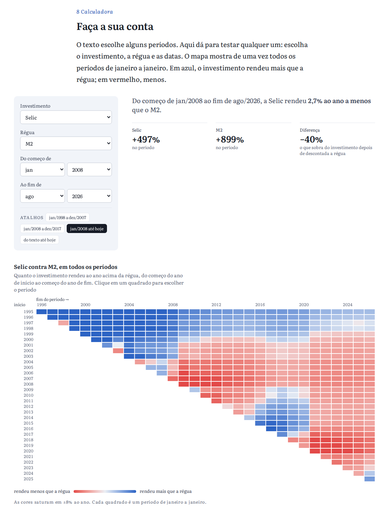

A conta da página (TypeScript) e a da análise (Python) são duas implementações da mesma coisa. O Python exporta
perguntas e respostas e os testes do site conferem que os dois dão os mesmos números.

## Como a conta é feita

Tudo parte de uma tabela de níveis: o valor de cada série no fim de cada mês. A variação entre dois meses é a
divisão de um nível pelo outro. Descontar uma régua também é dividir: uma aplicação que rendeu 21% enquanto a régua
subiu 10% ficou 10% acima dela. Os períodos seguem a convenção do texto ("de jan/2008 a jan/2018" vai do primeiro
dia de janeiro de 2008 ao último de dezembro de 2017). As fontes, as escolhas e as limitações estão em
[METODOLOGIA.md](METODOLOGIA.md).

## Dados

| Dado | Fonte |
|---|---|
| Selic, CDI, IPCA, base monetária, M1 a M4, PIB, dólar, salário mínimo e índice de imóveis | [SGS](https://www3.bcb.gov.br/sgspub/) (Banco Central) |
| Ibovespa, fechamento diário desde 1994 | [B3](https://www.b3.com.br/pt_br/market-data-e-indices/indices/indices-amplos/ibovespa.htm) |
| Taxas do Tesouro IPCA+ | [Tesouro Transparente](https://www.tesourotransparente.gov.br/ckan/dataset/taxas-dos-titulos-ofertados-pelo-tesouro-direto) |
| Ouro (média mensal em dólares), população, fecundidade e PIB em dólares | [Banco Mundial](https://www.worldbank.org/en/research/commodity-markets) |
| M1, M2, base monetária, papel-moeda, juro básico e títulos indexados à inflação dos Estados Unidos | [Federal Reserve](https://www.federalreserve.gov/datadownload/) (H.6 e H.15) |
| Juro básico e preços ao consumidor de 17 países | [BIS](https://data.bis.org/bulkdownload) |
| S&P 500 com dividendos | [Base aberta](https://github.com/datasets/s-and-p-500) a partir da série de Robert Shiller |
| Bitcoin | [Blockchain.com](https://www.blockchain.com/explorer/charts/market-price) |
| Nascimentos registrados | [SIDRA, tabela 2609](https://sidra.ibge.gov.br/tabela/2609) (IBGE) |
| Projeção da população brasileira até 2070 | [Projeções da População, revisão 2024](https://www.ibge.gov.br/estatisticas/sociais/populacao/9109-projecao-da-populacao.html) (IBGE) |
| Os 36 números citados no texto | Transcritos em `dados/manuais/afirmacoes.csv`, com o trecho de origem |

## Como rodar

Este post faz parte do [iblog](../../README.md) e tudo roda a partir da raiz do repositório. Precisa de
[uv](https://docs.astral.sh/uv/) (Python) e de Node.js 24.

```bash
uv sync                                             # instala as dependências
uv run python -m juros_negativos                    # baixa as fontes, trata e exporta os dados da página
uv run pytest posts/juros-negativos                 # testes
uv run jupyter lab posts/juros-negativos/notebooks  # abre os notebooks
```

`uv run python -m juros_negativos --atualizar` baixa as fontes de novo, mesmo que já estejam em `dados/brutos`.

A página:

```bash
npm install
npm test         # confere a conta em TypeScript contra a de Python
npm run dev      # http://localhost:5173/juros-negativos/
```

## Estrutura

```
post.json            título, resumo e data: é o que a capa do blog mostra
pagina/              a página (React + TypeScript) e o dados.json que ela lê
analise/             o pipeline em Python (pacote `juros_negativos`)
  fontes/            um módulo por fonte de dados (baixar + ler)
  tratamento.py      junta as fontes em quatro tabelas
  analise.py         as contas: variações, réguas, janelas, poder de compra
  estilo.py          aparência dos gráficos
  exportar_site.py   dados e casos de teste para a página
testes/              testes dos leitores, das contas e das tabelas tratadas (Python e TypeScript)
notebooks/           a análise, em seis partes
dados/manuais/       os números citados no texto, transcritos à mão
dados/tratados/      tabelas tratadas (parquet)
ferramentas/         a validação da quinta cor de gráfico
```

## Limitações

- **Imposto de renda e custos ficaram de fora.** Com 15% sobre o rendimento no resgate, o ganho real da Selic desde
  2008 cai de 4,1% para 3,4% ao ano.
- **O IPCA mede uma cesta média.** A inflação de cada família é diferente.
- **O ouro entra pela média do mês**, e o texto usou cotações de um dia. É a série em que os números mais diferem.
- **As janelas de 5 e 10 anos se sobrepõem**: não são experimentos independentes.
- **As causas da queda da natalidade**, que ocupam boa parte da segunda metade do texto, não são testáveis com
  estas séries. A checagem cobre só os números de população.
- **O futuro não está aqui.** O juro real voltou a ser alto no Brasil; nada garante que continue.

Isto é um estudo, não uma recomendação de investimento.

## Stack

Python 3.14, pandas, NumPy, matplotlib, pytest e ruff, gerenciados com uv. Página em React 19, TypeScript e Vite,
com gráficos em SVG (d3-scale e d3-shape).
